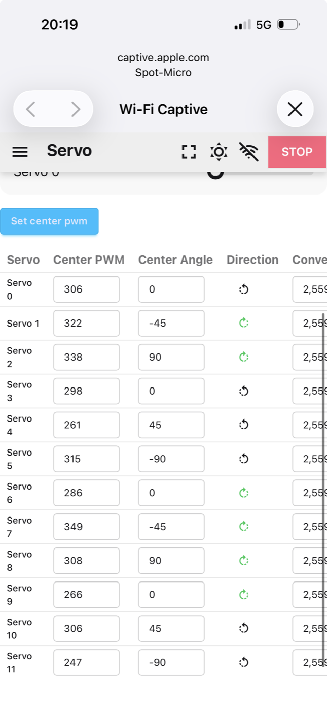
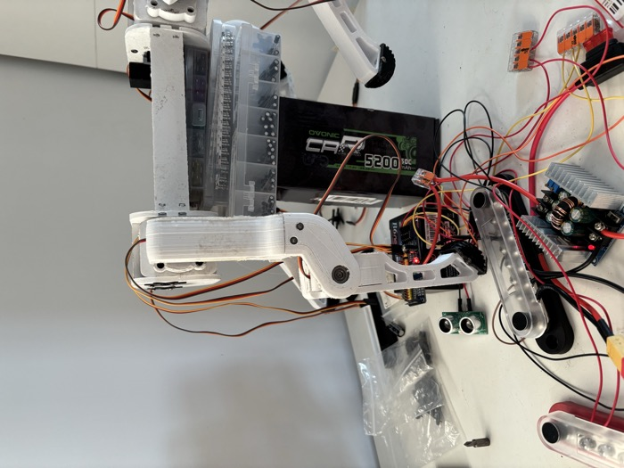
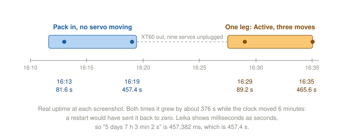
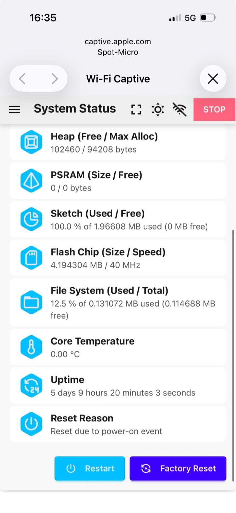

# Session 17 — The New ESP32

**Date:** October 8 and October 31, 2026

## What I set out to do

Put a new ESP32 where session 16 lost the old one, get back to where session 15 ended, and then look
for the brown-out again on a board that is known to be good.

## What I actually did

**Flashing, away from the bench (October 8).** The new board reads ESP32-D0WD-V3 rev 3.1, 4MB flash,
no PSRAM, CP2102 on `/dev/cu.usbserial-0001`, the same as the lost one, so Leika's configuration did
not change. It enters the bootloader by itself, no BOOT button. On USB alone: Upload Filesystem Image,
then Upload and Monitor. One `POWERON_RESET`, no `PSRAM` abort, `Spot-Micro` up on 192.168.4.1. The
Servo page showed 2.56 and the twelve Center PWMs without typing them: the calibration written into
the firmware in session 16 applied by itself.

*The new board's Servo page, straight after flashing. Nothing was typed in.*

The boot banner still says `d071f83-dirty`, October 3. That is a stale label the incremental build never
refreshes, not the binary's age: the twelve 2.56 and the twelve Center PWMs were found in `firmware.bin`.

**A short check before wiring (October 31).** The PCA9685 and the IMU had been on the lost board's 3.3V
when it died. Had either one been left shorted, the new board would have been next. Everything
unpowered, resistance from the 3.3V WAGO to the black bus bar: **kilohms, and rising**. That is the
capacitors on the line charging from the multimeter's test current. A short reads a few ohms and stays
there.

**The five Duponts back by colour,** from the table in `current-power-&-wiring-connections.md`. The two
reds are the only pair that can be swapped, and swapped they would put 5V on the IMU. Unpowered, by
resistance: red bus bar to VIN, **near 0 ohm**; 3.3V WAGO to 3V3, **near 0 ohm**. The second one first
read open, because the probe was touching plastic, not metal. The WAGO 221 has a small slot on its side
for a probe.

**On USB, XT60 unplugged.** `MPU6050 initialized successfully`, no I2C errors, and the I2C page lists
both devices. **The PCA9685 and the IMU survived session 16.** The `89 Hz` control loop warning seen on
October 8 with an empty bus is gone. One `1 Hz` line at boot falls during the IMU's 1.3s start-up
calibration, then nothing in the following 22 seconds.

*0x40 is the PCA9685, 0x68 the IMU.*

**The pack.** 7.66V after the fuse: 3.83V per cell, about half full, which fits sessions 13 to 16 having
run on it since the September charge. Enough for tonight: the 5V step-down needs anything above about 6V.

**The brown-out, again.** Leika's System Status shows the Reset Reason and the Uptime. Two tests, each
checked by reading the Uptime twice:

1. **Pack in, all twelve servos plugged, none moving.** Six minutes idle.
2. **One leg only**, as in session 15: XT60 out, channels 3 to 11 unplugged, the front left leg on 0, 1
   and 2. XT60 in, **Active** on, then each of the three servos moved from the Servo page's slider, one
   at a time.

**Active sends the leg straight down,** which first looked wrong. It is right: Active sends every joint to
angle zero, and in Leika zero is a straight leg. The knee at 90° is the pose the Center PWMs were
measured at, not the one Active sends to (session 15). A straight, vertical left leg also confirms the
calibration is there on the new board.

*Front left leg after Active: angle zero, straight down.*

**The board did not restart in either test.** Reset Reason stayed *power-on* both times, and the Uptime
grew with the clock. Leika's Uptime is milliseconds displayed as seconds, so it has to be converted
before reading it.

*How the Uptime proves there was no restart. The connection did drop once during test 1, but the Uptime
says the board stayed up: that was iOS closing its captive Wi-Fi sheet on a network with no internet.
Safari on 192.168.4.1 avoids it.*

*After the one-leg test: still the power-on reset from when the pack went in.*

## What I verified with the multimeter

| Measurement | Reading |
|---|---|
| 3.3V WAGO ↔ black bus bar, everything unpowered | kilohms, rising: no short |
| Red bus bar ↔ ESP32 VIN, unpowered | near 0 ohm |
| 3.3V WAGO ↔ ESP32 3V3, unpowered | near 0 ohm |
| Fuse test point ↔ black bus bar, pack in | 7.66V |

## What is still open

- **The brown-out did not come back, and that is not the same as fixed.** In the same configuration as
  session 15, one leg and three servos moved one at a time, it did not happen. Since then the board, the
  five Duponts and the firmware have all changed, and session 16 found a GND Dupont off the black bar.
  A loose ground is a plausible cause, not a proven one. The harder test is still to come: twelve servos
  activated together, the biggest current step the robot makes.
- **Channels 3 to 11 are unplugged.** Back on their channels before the next session: front right 3/4/5,
  rear left 6/7/8, rear right 9/10/11, in the order shoulder, upper leg, lower leg.
- **The PWM slider sends wherever it is touched,** not from where the servo is. On the Servo page it
  starts at 306 whatever the servo is doing, and a tap far from that makes the joint jump.
