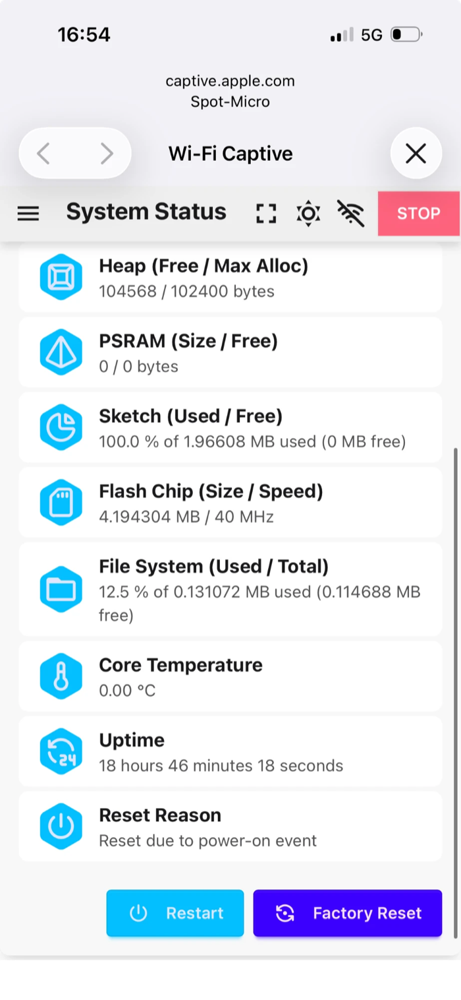
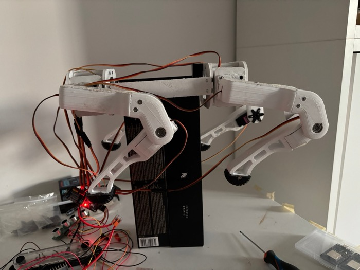
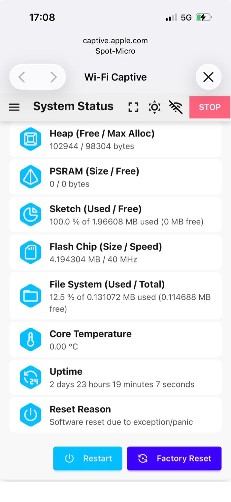

# Session 18 — Twelve Servos and the First Pose

**Date:** October 31, 2026

## What I set out to do

Put the nine servos unplugged in session 17 back on their channels, switch all twelve on at once (the
biggest current step the robot makes, so the real test for the brown-out), and then command the first
pose through Leika's kinematics: **Rest**, with the robot lifted.

## What I actually did

**The nine servos back on their channels,** with the XT60 out: front right 3/4/5, rear left 6/7/8, rear
right 9/10/11, each in the order shoulder, upper leg, lower leg. Servo leads gathered over the body,
away from where the legs swing.

**All twelve activated together, no restart.** Pack in, Servo page, **Active**: every leg went straight
down at once. Reset Reason stayed *power-on* and the Uptime grew from 16 to 68 real seconds in a minute
of clock time. Session 15's brown-out did not show up under the largest load the bench can make.

*After Active with all twelve plugged. Uptime 67,578 ms read as seconds: 67.6 real seconds.*

**The rear right knee stays bent by about 42° in the straight pose, and that is expected.** Leika clamps
every pulse to 125-600. A knee's straight-leg pulse is its Center PWM plus its Center Angle (±90°) times
2.56:

| Knee | Straight-leg pulse | Sent after the clamp | Left bent by |
|---|---|---|---|
| front left (ch2) | 568 | 568 | 0° |
| rear left (ch8) | 538 | 538 | 0° |
| front right (ch5) | 85 | 125 | about 16° |
| rear right (ch11) | 17 | 125 | about 42° |

Session 15 said both right knees stop "about 15°" short. That figure was worked out from the default
Center PWM of 306, before the real values were measured; ch11, whose horn sits 23° off, is the furthest
from it. A walking knee works around 90° of bend, far from this limit.

**Rest: legs folded, the first pose from Leika's kinematics.** Choosing a mode activates the servos by
itself; the Servo page's Active is only a calibration tool. Worked out with Leika's own IK and this
robot's calibration, Rest puts each thigh **72° from vertical**, nearly level and pointing at the tail, the
knee closed to a **45° V**, and the foot under the hip, **about 10 cm below its pivot**. No pulse comes
near the clamp.

*Rest, robot lifted. All four legs take the same shape, so the Directions are right.*

**The first attempt stopped halfway.** The legs folded only part of the way, the app still showing Rest.
After unplugging and reconnecting the pack, the shoulders moved erratically for a moment and then the
legs went fully into Rest. Switching Stand, Rest, Stand, Rest afterwards worked every time, the legs
moving slowly: Leika eases into each pose instead of jumping.

**Then a crash, not a brown-out.** Before those screenshots the board had stopped answering commands, and
the pack was unplugged and reconnected. System Status then read **Software reset due to exception/panic**,
with an Uptime that puts the restart at about the moment the pack went back in. A reconnect alone reads
power-on, so the firmware crashed within seconds of booting, possibly at the phone's first command after
reconnecting. Over the next two minutes of Stand and Rest it did not restart again: 257 to 357 real
seconds.

*A panic is the program stopping on an illegal operation, then restarting itself. Its cause is printed
on the serial port at that moment and saved nowhere: core dumps are disabled in Leika's configuration.*

**The servos twitch while the rails rise or fall.** On power-up the shoulders moved before the first pulse;
on power-down the rear left shoulder swung as the rails decayed and stayed there. Unpowered, the MG996R
holds by gear friction alone: it feels stiff but it is not driven. It goes back to its place at the next
power-up, and it is not turned by hand.

## What I verified with the multimeter

Nothing new: no wire was changed. The voltages are session 17's.

## What is still open

- **The firmware stops responding and crashes.** Two symptoms, likely one cause, and neither is the
  supply: the board stopped answering commands, and after a power cycle it panicked. The first, half-way
  Rest may have been the same thing. Leika prints the backtrace only on the serial port, which cannot be
  read with the pack in (USB and the pack never together). Next session reproduces it on USB alone, the
  servos unpowered, with the serial monitor open.
- **Session 15's brown-out** did not return with one leg (session 17) or with twelve servos activated
  together. It stays in the log as seen once, on a board that died the next day.
- **The electronics move onto the body** after the crash is found, not before: debugging is easier on the
  bench with the Mac next to it.
