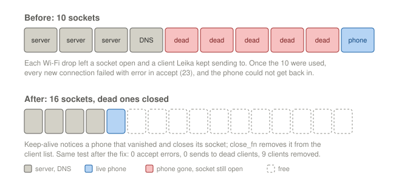

# Session 19 — The Firmware Crash

**Date:** October 31, 2026

## What I set out to do

Session 18 ended on two firmware symptoms: the board stopped answering commands, and after the pack was
reconnected it read *Software reset due to exception/panic*. The goal: find where it crashes. A panic
prints its backtrace on the serial port and nowhere else, so this session ran on **USB alone, XT60
unplugged**: the servos stayed plugged but unpowered. A firmware bug does not need them.

## What I actually did

**A serial log to a file,** every line timestamped, so a crash is kept even when nobody is watching the
screen. Then the phone repeated session 18: Rest and Stand, the Servo page's Active, Wi-Fi off and on,
the captive Wi-Fi sheet, and resets of the board while the page was open.

**"Stops answering" was found first.** Each time the phone's Wi-Fi dropped, the log showed hundreds of
`Failed to send message to client 59`, then at 17:42:43 `httpd_accept_conn: error in accept (23)`, and
from there every new connection was refused. Two Leika bugs together:

1. **A client left Leika's list only on a clean close.** A phone that drops off Wi-Fi sends no close
   frame, so its socket stayed open and Leika kept sending it data ten times a second.
2. **lwIP had 10 sockets** and the web server wants up to 7 plus 3 of its own, with the captive portal's
   DNS taking one more. The table filled before the server's own purge of old connections could start.
   Error 23 means "no free socket".



*Why the robot stopped answering, and the fix.*

**The Restart button never worked.** The app posts an empty request and the server answered
`400 Invalid content length`. The board did not restart, and the reconnects that followed filled the
socket table.

**The fixes, as Leika changes 9 to 13** (all in `firmware/leika-config.md`): keep-alive, so the server
notices a phone that vanished; a `close_fn` that removes a client whenever its socket closes; 16
sockets; empty requests accepted; and **core dumps saved to flash**, so a panic on the pack is kept for
reading over USB afterwards.

**A panic, caught and decoded.** With Restart working, the next Restart crashed:
`Guru Meditation Error: Core 0 panic'ed (LoadProhibited)`, saved to flash. Decoded with `addr2line`
against the build's `firmware.elf`:

```
pb_common.c:14        load_descriptor_values
pb_encode.c:561       pb_get_encoded_size
webserver.cpp:298     WebServer::sendOk
system_service.cpp:54 handleRestart
```

`sendOk()` called `send(req, 200, nullptr, 0)`. A bare `nullptr` is a better match for Leika's protobuf
template overload than for the raw-bytes one, so it encoded a message with a null descriptor and read
address 0x10. Every Restart, reset or sleep went through it; the 400 had hidden it. One cast fixes it.
The saved dump was erased afterwards, so the next one found will be new.

**The same tests on the fixed firmware:**

| | Before | After |
|---|---|---|
| `error in accept (23)` | dozens, then no connection | 0 |
| sends to clients that are gone | hundreds | 0 |
| clients removed when they vanish | never | 9, each time |
| Restart | `400`, no restart | restarts, no panic |

**Session 18's panic was not reproduced.** Three resets with the page open and a mode sent at once, a
dozen Wi-Fi drops, on both firmwares: no crash on USB. It may need the servos powered. From now on, if it
happens on the pack, the board keeps it.

**The IMU failed to start on 2 of 8 boots,** `MPU6050 initialization failed` with an I2C timeout, and
`SpotControlLoopEntry: 89 Hz` came back with it. Every boot this session was a reset of a running board
(from the Mac, after flashing, after the panic), never a cold power-on, so warm and cold cannot be told
apart yet. A reset in the middle of an I2C transfer can leave the IMU holding the data line low until it
loses power; that is a hypothesis, not checked. Leika carries on without
the IMU, and does not crash.

## What I verified with the multimeter

Nothing: the session was firmware only, on USB.

## What is still open

- **Session 18's panic.** Not found on USB. Core dumps are on: when it happens on the pack, read it over
  USB before anything else (`firmware/leika-config.md`, "Reading a crash after the fact").
- **The IMU after a reset.** Check whether it fails only on warm resets. If so, the cure is an I2C bus
  recovery at boot (nine clock pulses on SCL), or the IMU powered from a pin the firmware can cycle.
- **All five fixes are local to the `kalebv2` branch** of the Leika clone, like the first eight. The three
  web server bugs are upstream bugs, worth reporting to runeharlyk.
