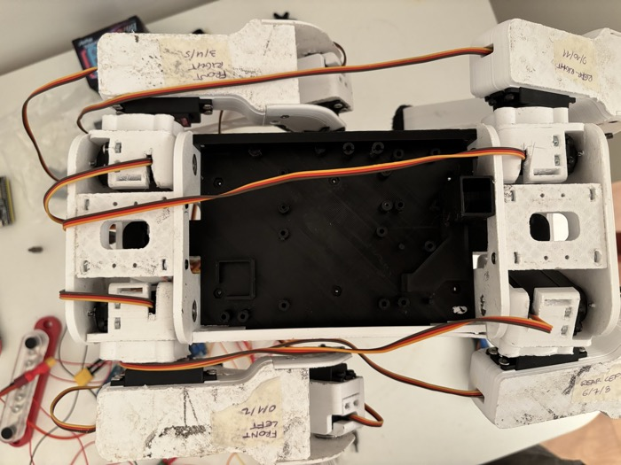
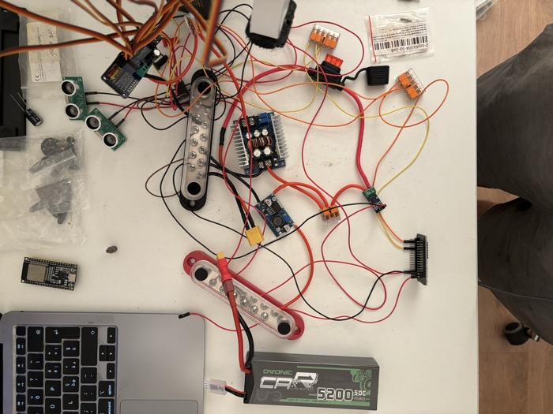
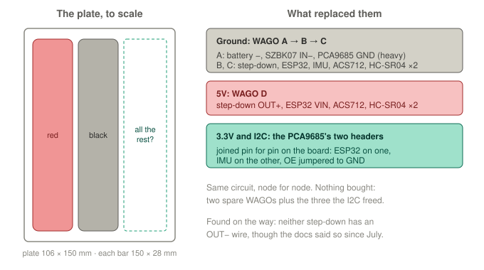
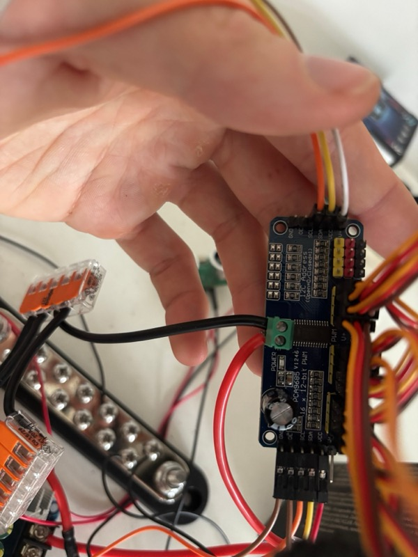
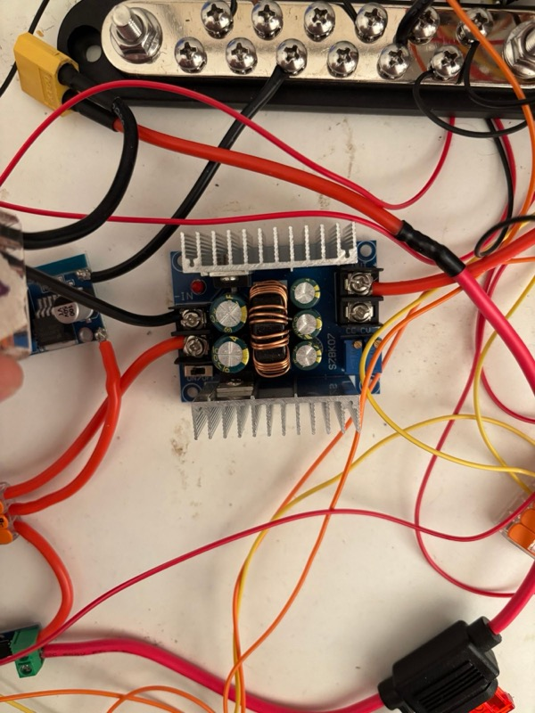
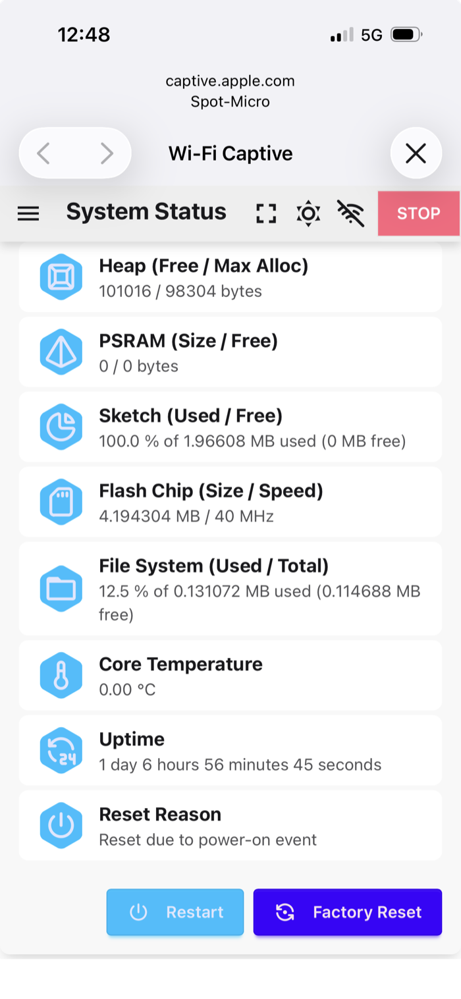
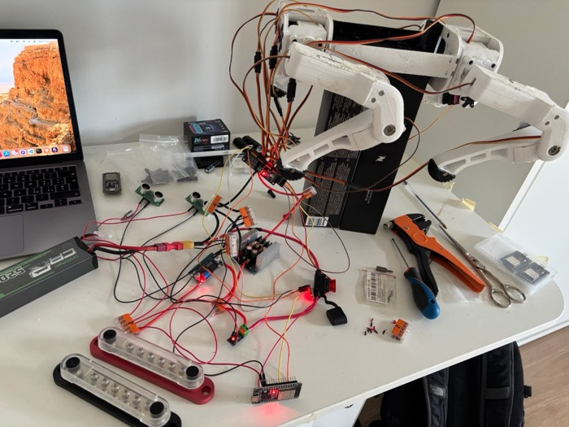

# Session 20 — The Bus Bars Come Out

**Date:** October 31 and November 1, 2026

## What I set out to do

Move the electronics from the bench onto the circuitry plate in the body. That became something else
before a wire moved: the two bus bars do not fit on the plate. So the session replaced them on the bench,
where every wire is easy to reach and measure, and the move itself is session 21.

## What I actually did

**The plate, measured from michaelkubina's STL.** `Circuitry_Mountingplate_SZBK07_Extended.stl` is
106 × 237mm, but 87mm of that is the two tabs that clip it into the chassis: the mounting area is about
**106 × 150mm**, with standoffs for the modules of the reference build. The bus bars, from the seller's
drawing, are **150 × 28mm** each. Side by side they take the whole length of the plate and more than half
its width, over the standoffs.

*The plate in the chassis, before anything goes on it.*

*The bench before the session: the two bars are the largest parts on it.*

**What replaced them, without buying anything.** Two ideas were dropped on the way: an ESP32 expansion
board (one header per pin, but I2C is a bus with two devices now and an OLED later) and a soldered
perfboard with rails (it would work, but it costs a purchase and solves a problem the bench already
solves). The answer was on the bench:

- **The PCA9685 has a 6-pin header at each end, joined pin for pin on the board.** Checked by continuity,
  all six pairs. So the ESP32 plugs into one header and the IMU into the other, and the three WAGOs that
  carried 3.3V, SDA and SCL are freed. OE is jumpered to GND on the same header.
- **Ground: three WAGO 221-415 in a chain.** Every heavy ground on A (battery, SZBK07, PCA9685), so the
  battery and servo current never crosses a WAGO-to-WAGO link. B and C take the logic grounds.
- **5V: a fourth WAGO, D.** Its five ports are exactly the five wires the red bar had.

ACS712 and the two HC-SR04 stay connected even though nothing reads them yet: unplugging them only to plug
them back later is work for nothing. The bars are off the bench and kept.

*Why the bars came out, and what took their place. Electrically the same circuit, node for node.*

*The PCA9685 with both headers in use: the IMU on one, the ESP32 and the OE–GND jumper on the other. V+
stays free on both.*

**Two errors in the documentation.** Each wire was traced from its module before it was unscrewed from a
bar. The **SZBK07's OUT− has no wire**, and neither has the **LM2596's**. `current-power-&-wiring-connections.md`
had both on the black bar, "Verified", since July. Both modules share ground between input and output, so
the return current comes back through IN−; that is how it has worked all along, including twelve servos
moving. They were left as they are, to keep the circuit identical while everything else moved. Wiring
them to WAGO A is now in the backlog as a change of its own.

*The SZBK07: IN− and IN+ on the left, OUT+ on the right, OUT− empty.*

**Every count was checked against reality, not the file.** Before each WAGO the bar was counted; at the
end the black bar was empty, so no wire existed that the documentation did not know about.

**The order of the work** was ground first, and it stalled at WAGO C: the two spare WAGOs were used, and
the three the I2C would free were still holding wires. Moving the I2C first is the right order.

## What I verified with the multimeter

| Measurement | Reading |
|---|---|
| Bench off: XT60, fuse, USB out; ground to 5V node | 0V |
| PCA9685 header 1 ↔ header 2, all six pins | beep, each pair |
| OE ↔ GND, header 1 (the jumper) | beep |
| SCL ↔ GND, header 1 | no beep |
| WAGO A ↔ WAGO C (both links) | beep |
| WAGO A ↔ ESP32 GND pin | beep |
| WAGO D ↔ ESP32 VIN pin | beep |
| WAGO D, PCA9685 VCC, servo rail WAGO ↔ ground | kilohms rising: no short |
| Battery split WAGO ↔ ground | open: no short on battery + |
| WAGO D ↔ ground, pack in | 4.95V (4.98V before) |
| Servo rail WAGO ↔ ground, pack in | 6.01V |

A first reading of 5.96V on WAGO D was a misread; measured again, 4.95V.

**USB alone, from cold**, with the serial port opened without resetting the board: IMU initialized at the
first try, no I2C errors, no saved core dump, and the I2C page lists **0x40 and 0x68**. **With the pack:**
Rest works, and System Status reads *power-on*.

*After Rest on the new wiring. Uptime 111,405 ms, shown by Leika as seconds: 111 real seconds.*

*The bench at the end: the two bars unwired in the foreground, the robot in Rest on the new wiring.*

## What is still open

- **The move onto the plate**, session 21, with the LiPo brackets fitted first.
- **The two OUT− wires**, to WAGO A: not needed to work, a change of its own.
- **The wiring drawing still shows a 38-pin ESP32.** The board on the bench since session 17 has 30 pins;
  the five pins used are the same.
- **Dupont in WAGOs** is below the WAGO's specified minimum. Every one was folded back and tug-tested; they
  are suspects whenever something stops answering.
